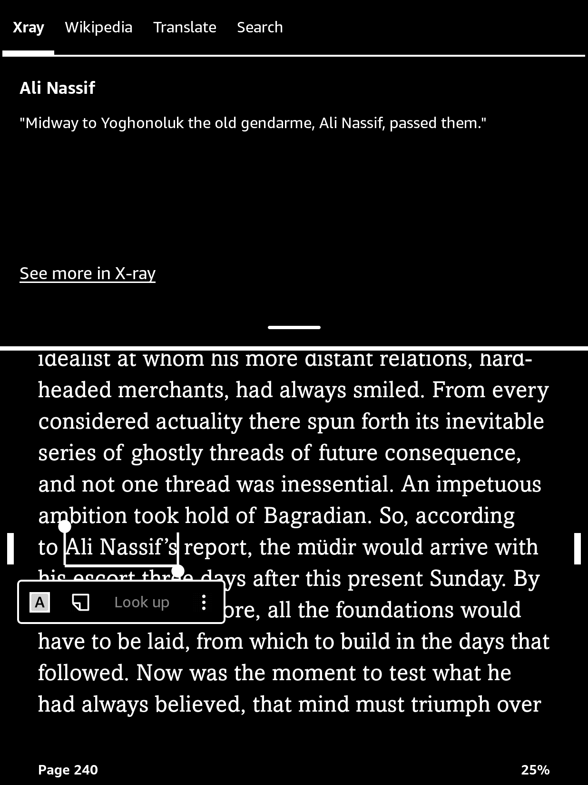
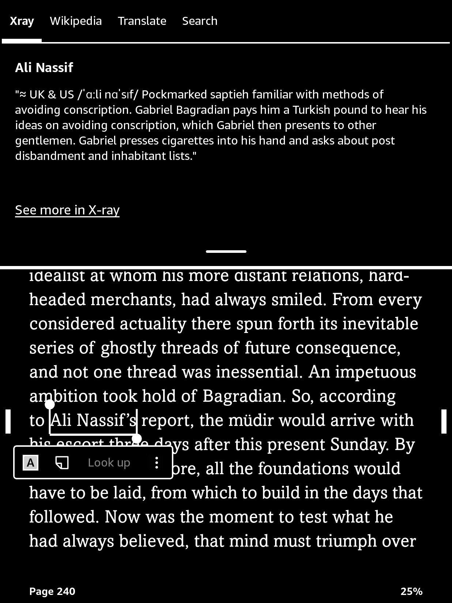
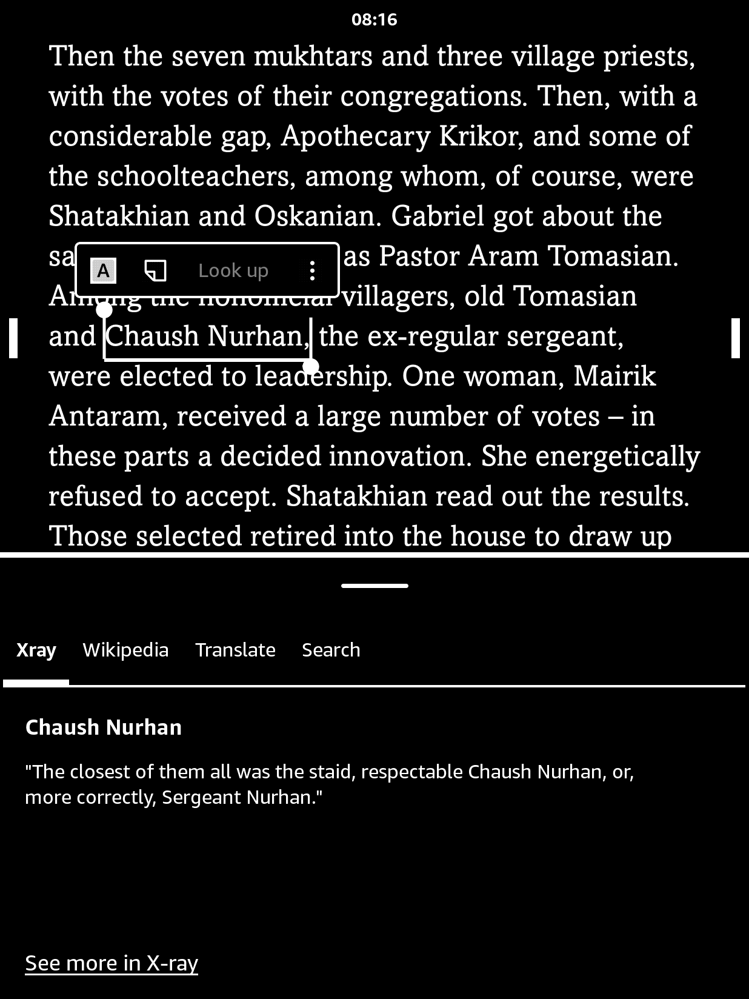
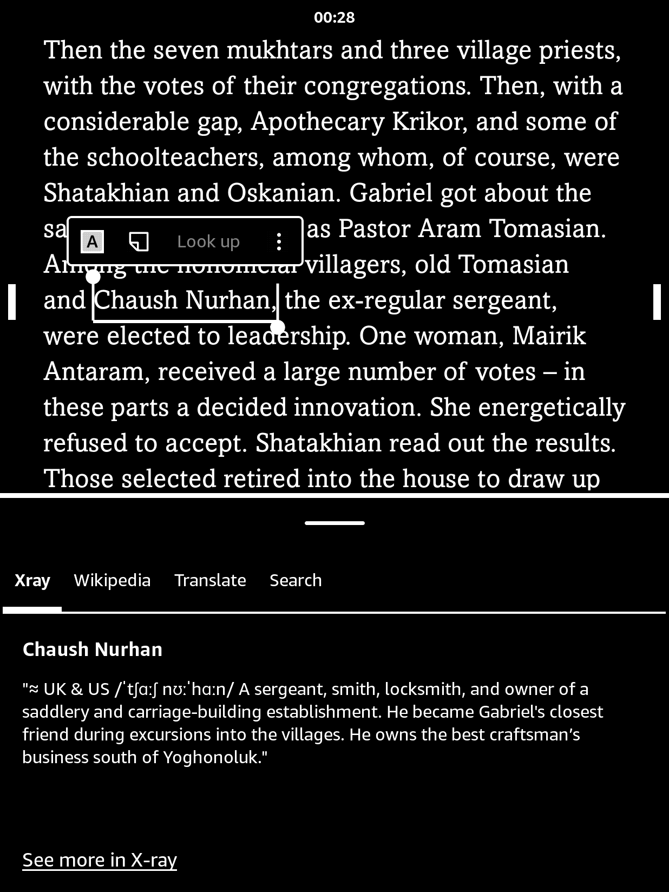

# Enhance X-Ray

A calibre plugin (internal name **Claude X-Ray**, toolbar button **Enhance X-Ray**) that improves the
X-Ray files WordDumb makes for Kindle books. It fixes who the characters are, rewrites entity names and
cards, adds relationships and UK/US pronunciation lines. It runs on the Claude API or on a local model
(Qwen3.6 through oMLX), chosen in a dialog. If the model is unreachable it leaves the X-Ray untouched.

Current version: **1.2.15** (Mac). Platform: macOS, Apple Silicon, calibre 9.x with KFX Input/Output and the
WordDumb 3.36.x.

## Example

*The Forty Days of Musa Dagh* on a Kindle, tapping a name in the book. Left: the X-Ray as WordDumb makes it.
Right: after Enhance X-Ray, with a pronunciation line (`≈` marks a model's best guess) and a card written from the
book instead of a raw excerpt.

| Before | After |
|:---:|:---:|
|  |  |
|  |  |

Book excerpts appear only to illustrate the plugin.

## Layout

| Path | What |
|---|---|
| `__init__.py`, `ui.py`, `dialog.py` | plugin entry, toolbar action, provider dialog |
| `enrich.py` | the worker (cards, ties, Wikipedia check, backups, integrity gate) |
| `cast_pass.py`, `kin_words.py`, `book_brief.py`, `ipa_pass.py` | cast pass, kin words, library-metadata brief, pronunciation lines |
| `tests/` | five suites, standard library only, no oMLX needed |
| `tools/` | dev scripts (cast pass alone, pronunciation pass alone, dialog smoke test, end-to-end run) |

## Download

[**ClaudeXRay_mac_v1.2.15.zip**](https://github.com/janinderrana/Enhance-X-Ray/releases/download/v1.2.15/ClaudeXRay_mac_v1.2.15.zip)
([all releases](https://github.com/janinderrana/Enhance-X-Ray/releases)). While the repo is private you need to be signed in
to GitHub with an account that has access. SHA-256: `359a03858107d0853c17793c172ed1069a841857062442590ca7c034120bf4e7`.

## Build and install

```bash
./build.sh                      # -> dist/ClaudeXRay_mac_v1.2.15.zip
# quit calibre first
/Applications/calibre.app/Contents/MacOS/calibre-customize -a dist/ClaudeXRay_mac_v1.2.15.zip
```

`./deploy.sh` does the build, the calibre install (with a backup of the installed plugin) and a copy of the zip to a
NAS folder in one step, so all three stay the same. Put `NAS_DIR="<folder>"` in a git-ignored `.deploy.env`; calibre
must be closed. Use `--no-nas` or `--no-install` to skip a step.

The Claude path also needs a venv with the `anthropic` package and a key in the macOS Keychain
(service `claude-xray`); the local path needs oMLX running and uses the standard library only.

## Dependencies

**Required**

| Dependency | Used for | Notes |
|---|---|---|
| macOS on Apple Silicon | the whole setup | built and run on a Mac mini (M-series, 64 GB); the plugin has platform guards but is untested elsewhere |
| [calibre](https://github.com/kovidgoyal/calibre) | host application; its Qt, config, library and MOBI reader are used | plugin minimum 5.0; run on 9.15 |
| [WordDumb](https://github.com/xxyzz/WordDumb) | creates the X-Ray files this plugin enhances | run with 3.36.0; WordDumb installs its own dependencies |
| [KFX Input](https://www.mobileread.com/forums/showthread.php?t=291290) | the plugin reads the book's KFX text positions through its `kfxlib` | run with 2.34.2 |
| [KFX Output](https://www.mobileread.com/forums/showthread.php?t=272407) | converts books to KFX, which WordDumb needs | run with 2.22.0 |
| Amazon Kindle Previewer | does the actual KFX conversion for KFX Output | Previewer 4 on Apple Silicon also needs Rosetta |

**For the local model route (free, offline)**

| Dependency | Used for | Notes |
|---|---|---|
| [oMLX](https://github.com/jundot/omlx) | local OpenAI-compatible server at `127.0.0.1:8000` | Apache-2.0; the worker uses only the Python standard library |
| Qwen3.6-35B-A3B (oQ4e-mtp build) | default model for cards, cast pass, ties, pronunciation | loaded through oMLX |
| Gemma 4 26B-A4B | optional bulk-tier model | loaded and unloaded per run |

**For the Claude API route**

| Dependency | Used for | Notes |
|---|---|---|
| Anthropic API key | the Claude provider | stored in the macOS Keychain (service `claude-xray`) or `ANTHROPIC_API_KEY` |
| Python 3 venv with `anthropic` | the Claude provider (`pydantic` comes with it) | `~/.claude-xray/venv`; not needed for the local route |

**Optional**

| Dependency | Used for | Notes |
|---|---|---|
| Collins English Dictionary (MOBI, your own copy in the calibre library) | British IPA for names in the pronunciation lines | not distributed here; without it the local model does every name |
| Wikipedia (`en.wikipedia.org` API) | fact check of relationships | only page titles leave the Mac; skipped if offline or unticked |
| macOS `security` and `caffeinate` | Keychain lookup; keeps the Mac awake during a run | built into macOS |

## Notes

- X-Ray databases (`*.asc`), backups and run checkpoints are book data and are git-ignored.
- No API keys are stored in the repo. The Claude key lives in the macOS Keychain (service `claude-xray`).

## Credits

Enhance X-Ray builds on the work of others and is an independent project, not affiliated with any of them.

- **[WordDumb](https://github.com/xxyzz/WordDumb)** by xxyzz creates the X-Ray this plugin improves.
- **[calibre](https://github.com/kovidgoyal/calibre)** by Kovid Goyal is the platform it runs in.
- **KFX Input** and **KFX Output** by jhowell on MobileRead ([Input](https://www.mobileread.com/forums/showthread.php?t=291290), [Output](https://www.mobileread.com/forums/showthread.php?t=272407)) read and write the KFX format.
- **[oMLX](https://github.com/jundot/omlx)** by jundot serves the local models on Apple Silicon.
- **Qwen** (Alibaba) and **Gemma** (Google) are the local models; **Claude** (Anthropic) is the optional API route.
- **Collins English Dictionary** (HarperCollins) is the source of the British pronunciations, read from your own copy.
- **Wikipedia** contributors supply the reference text used for the relationship fact check.

## License and contributing

Licensed under the [GNU General Public License v3.0 or later](LICENSE), the same family of license as calibre,
WordDumb and the KFX plugins. oMLX (Apache-2.0) runs as a separate local server. See [CONTRIBUTING.md](CONTRIBUTING.md)
to send a change; only the maintainer approves and merges pull requests.
